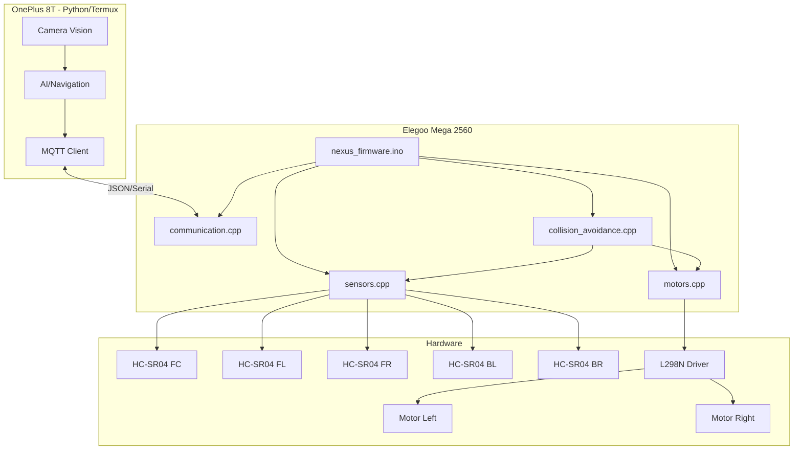

# NexusTrack Firmware Architecture Plan

## Systemöversikt

**Plattform:** NexusTrack - Modulär autonom robotplattform
**MCU:** Elegoo Mega 2560 (ATmega2560)
**Huvudhjärna:** OnePlus 8T (Python/Termux)
**Kommunikation:** MQTT över USB-C Hub

### Utvecklingsstrategi
**Fas 0:** RC-bil prototyp för snabb testning av sensorer och MQTT
**Fas 1+:** Bandvagnsplattform för slutlig implementation

### Komponenter
- 1x Elegoo Mega 2560
- 1x L298N Motor Driver
- 5x HC-SR04 Ultraljudssensorer
- 1x USB-C Hub (Benfei) för kommunikation med OnePlus 8T
- 1x Servo (för RC-bil styrning i Fas 0)

### Chassimått
**RC-bil prototyp (Fas 0):** Varierar beroende på RC-bil
**Bandvagn (Fas 1+):** 180mm × 260mm × 3mm (från parameters.txt)

---

## 1. Sensorplacering och Pinout

### HC-SR04 Sensorplacering
Föreslår följande placering för optimal 360° täckning:

```
        [FRONT]
    [FL]   [FC]   [FR]
         [ROBOT]
    [BL]         [BR]
        [BACK]
```

- **FC (Front Center):** Primär framåtsensor
- **FL (Front Left):** Vänster framhörn (45°)
- **FR (Front Right):** Höger framhörn (45°)
- **BL (Back Left):** Vänster bakhörn (135°)
- **BR (Back Right):** Höger bakhörn (135°)

### Pinout Schema

#### HC-SR04 Sensorer (10 pins totalt)
```cpp
// Front Center
#define TRIG_FC 22
#define ECHO_FC 23

// Front Left
#define TRIG_FL 24
#define ECHO_FL 25

// Front Right
#define TRIG_FR 26
#define ECHO_FR 27

// Back Left
#define TRIG_BL 28
#define ECHO_BL 29

// Back Right
#define TRIG_BR 30
#define ECHO_BR 31
```

#### L298N Motor Driver (6 pins)
```cpp
// Motor A (Vänster band / Bakre motor)
#define MOTOR_A_IN1 2
#define MOTOR_A_IN2 3
#define MOTOR_A_PWM 4  // ENA

// Motor B (Höger band / Bakre motor)
#define MOTOR_B_IN1 5
#define MOTOR_B_IN2 6
#define MOTOR_B_PWM 7  // ENB
```

#### Servo Styrning (för RC-bil prototyp - Fas 0)
```cpp
#define SERVO_PIN 9    // PWM-pin för servo
#define SERVO_CENTER 90
#define SERVO_MAX_LEFT 45
#define SERVO_MAX_RIGHT 135
```

#### Kommunikation
```cpp
// Serial för MQTT-kommunikation med OnePlus 8T
// Serial (USB): 115200 baud
```

---

## 2. Firmware Struktur

### Huvudarkitektur

```
nexus_firmware/
├── nexus_firmware.ino          # Huvudfil med setup() och loop()
├── config.h                     # Konfiguration och konstanter
├── sensors.h                    # Sensorhantering
├── sensors.cpp
├── motors.h                     # Motorstyrning
├── motors.cpp
├── communication.h              # MQTT/Serial kommunikation
├── communication.cpp
├── collision_avoidance.h        # Kollisionsundvikande logik
└── collision_avoidance.cpp
```

### Modularisering

#### 2.1 config.h
Centraliserad konfiguration för alla pins, konstanter och inställningar.

```cpp
#ifndef CONFIG_H
#define CONFIG_H

// Version
#define FIRMWARE_VERSION "1.0.0"

// Serial Communication
#define SERIAL_BAUD 115200
#define MQTT_UPDATE_INTERVAL 100  // ms

// Sensor Configuration
#define NUM_SENSORS 5
#define MAX_DISTANCE 200          // cm
#define SENSOR_TIMEOUT 30000      // microseconds
#define COLLISION_THRESHOLD 30    // cm
#define WARNING_THRESHOLD 50      // cm

// Motor Configuration
#define MAX_SPEED 255
#define MIN_SPEED 0
#define TURN_SPEED 180
#define CRUISE_SPEED 200

// Drive Mode Configuration
#define DRIVE_MODE_SERVO 0    // RC-bil med servo-styrning (Fas 0)
#define DRIVE_MODE_SKID 1     // Bandvagn med skid-steer (Fas 1+)
#define CURRENT_DRIVE_MODE DRIVE_MODE_SERVO  // Ändra baserat på plattform

// Pin Definitions (se ovan)
// ...

#endif
```

#### 2.2 sensors.h/cpp
Hanterar alla HC-SR04-sensorer med NewPing-biblioteket.

**Huvudfunktioner:**
- `initSensors()` - Initialiserar alla sensorer
- `readAllSensors()` - Läser alla sensorer och returnerar array
- `getSensorDistance(sensorID)` - Läser specifik sensor
- `getClosestObstacle()` - Returnerar närmaste hinder och riktning
- `printSensorData()` - Debug-utskrift

**Datastruktur:**
```cpp
struct SensorData {
    uint8_t id;
    const char* name;
    uint16_t distance;  // cm
    uint32_t timestamp;
    bool valid;
};

enum SensorID {
    SENSOR_FC = 0,
    SENSOR_FL = 1,
    SENSOR_FR = 2,
    SENSOR_BL = 3,
    SENSOR_BR = 4
};
```

**Optimering:**
- Använd NewPing-biblioteket för effektiv pulshantering
- Implementera round-robin läsning för att undvika interferens
- Timeout-hantering för felaktiga läsningar
- Medelvärdesfiltrering för stabilitet

#### 2.3 motors.h/cpp
Flexibel motorstyrning som stödjer både servo-styrning (RC-bil) och skid-steer (bandvagn).

**Huvudfunktioner:**
- `initMotors()` - Initialiserar motorpins och servo (om DRIVE_MODE_SERVO)
- `setDriveMode(mode)` - Växlar mellan servo och skid-steer
- `setMotorSpeed(motor, speed)` - Sätter hastighet (-255 till 255)
- `setSteeringAngle(angle)` - Sätter servo-vinkel (endast DRIVE_MODE_SERVO)
- `moveForward(speed)` - Framåt
- `moveBackward(speed)` - Bakåt
- `turnLeft(speed)` - Sväng vänster (servo eller spot turn)
- `turnRight(speed)` - Sväng höger (servo eller spot turn)
- `pivotLeft(speed)` - Pivot vänster (endast skid-steer)
- `pivotRight(speed)` - Pivot höger (endast skid-steer)
- `stop()` - Stopp
- `emergencyStop()` - Nödstopp

**Datastruktur:**
```cpp
enum MotorID {
    MOTOR_LEFT = 0,
    MOTOR_RIGHT = 1,
    MOTOR_DRIVE = 0     // Alias för RC-bil (bakre motor)
};

enum DriveMode {
    MODE_SERVO = 0,     // RC-bil: En motor + servo
    MODE_SKID = 1       // Bandvagn: Två motorer, skid-steer
};

struct MotorState {
    int16_t speed;      // -255 till 255
    uint8_t direction;  // 0=stop, 1=forward, 2=backward
    bool enabled;
};

struct ServoState {
    uint8_t angle;      // 0-180 grader
    bool attached;
};
```

**Implementeringsdetaljer:**

*Servo-läge (RC-bil):*
- Motor A driver bakre motor (framåt/bakåt)
- Servo på pin 9 styr framhjulen
- Enklare att testa sensorer i hög hastighet

*Skid-steer-läge (Bandvagn):*
- Motor A driver vänster band
- Motor B driver höger band
- Svängar genom differentiell hastighet

#### 2.4 communication.h/cpp
Hanterar Serial-kommunikation med OnePlus 8T via MQTT-protokoll.

**Meddelandeformat (JSON):**

**Från Arduino till OnePlus:**
```json
{
    "type": "sensor_data",
    "timestamp": 12345,
    "sensors": {
        "fc": 45,
        "fl": 67,
        "fr": 52,
        "bl": 120,
        "br": 115
    },
    "motors": {
        "left": 200,
        "right": 200
    },
    "status": "running"
}
```

**Från OnePlus till Arduino:**
```json
{
    "type": "command",
    "action": "move",
    "params": {
        "direction": "forward",
        "speed": 200
    }
}
```

**Kommandon:**
- `move` - Rörelse (forward, backward, left, right, stop)
- `set_speed` - Sätt hastighet
- `emergency_stop` - Nödstopp
- `get_status` - Begär statusuppdatering
- `calibrate` - Kalibrera sensorer

**Huvudfunktioner:**
- `initCommunication()` - Initialiserar Serial
- `sendSensorData()` - Skickar sensordata som JSON
- `sendStatus()` - Skickar statusmeddelande
- `receiveCommand()` - Tar emot och parsar kommandon
- `executeCommand()` - Utför mottaget kommando

#### 2.5 collision_avoidance.h/cpp
Implementerar kollisionsundvikande logik baserat på sensordata.

**Huvudfunktioner:**
- `checkCollisionRisk()` - Analyserar sensordata för kollisionsrisk
- `calculateSafeDirection()` - Beräknar säker färdriktning
- `emergencyAvoidance()` - Akut undanmanöver
- `getAvoidanceVector()` - Returnerar undvikningsvektor

**Logik:**
```cpp
enum CollisionRisk {
    RISK_NONE = 0,
    RISK_LOW = 1,
    RISK_MEDIUM = 2,
    RISK_HIGH = 3,
    RISK_CRITICAL = 4
};

struct AvoidanceAction {
    CollisionRisk risk;
    const char* action;  // "stop", "slow", "turn_left", "turn_right", "reverse"
    uint8_t priority;
};
```

---

## 3. Huvudprogram (nexus_firmware.ino)

### Setup-sekvens
```cpp
void setup() {
    // 1. Initialisera Serial
    initCommunication();
    
    // 2. Initialisera sensorer
    initSensors();
    
    // 3. Initialisera motorer
    initMotors();
    
    // 4. Skicka startup-meddelande
    sendStatus("initialized");
    
    // 5. Vänta på OnePlus-anslutning
    waitForConnection();
}
```

### Loop-struktur
```cpp
void loop() {
    // 1. Läs sensorer (round-robin, en per iteration)
    static uint8_t currentSensor = 0;
    readSensor(currentSensor);
    currentSensor = (currentSensor + 1) % NUM_SENSORS;
    
    // 2. Kontrollera kollisionsrisk
    CollisionRisk risk = checkCollisionRisk();
    
    // 3. Hantera kritiska situationer
    if (risk >= RISK_HIGH) {
        emergencyAvoidance();
    }
    
    // 4. Ta emot kommandon från OnePlus
    if (Serial.available()) {
        receiveCommand();
    }
    
    // 5. Skicka sensordata (med intervall)
    static uint32_t lastUpdate = 0;
    if (millis() - lastUpdate >= MQTT_UPDATE_INTERVAL) {
        sendSensorData();
        lastUpdate = millis();
    }
    
    // 6. Uppdatera motorstyrning
    updateMotors();
}
```

---

## 4. Biblioteksberoenden

### Nödvändiga bibliotek
```cpp
#include <Arduino.h>
#include <NewPing.h>           // För HC-SR04 sensorer
#include <ArduinoJson.h>       // För JSON-kommunikation
#include <Servo.h>             // För servo-styrning (Fas 0)
```

### Installation
```bash
# Via Arduino Library Manager:
- NewPing by Tim Eckel
- ArduinoJson by Benoit Blanchon (v6.x)
- Servo (ingår i Arduino IDE)
```

---

## 5. State Machine

### Robotens tillstånd
```cpp
enum RobotState {
    STATE_IDLE,           // Väntar på kommando
    STATE_MANUAL,         // Manuell styrning från OnePlus
    STATE_AUTONOMOUS,     // Autonom körning
    STATE_EMERGENCY,      // Nödläge
    STATE_CALIBRATING,    // Kalibrering
    STATE_ERROR           // Felläge
};
```

### Tillståndsövergångar
```
IDLE → MANUAL (kommando från OnePlus)
MANUAL → AUTONOMOUS (auto-mode aktiverad)
ANY → EMERGENCY (kritisk kollisionsrisk)
EMERGENCY → IDLE (efter säker stopp)
```

---

## 6. Säkerhetsfunktioner

### Prioriterade säkerhetsregler
1. **Kollisionsundvikande har högsta prioritet** - Kan överrida alla kommandon
2. **Watchdog-timer** - Stoppar robot om ingen kommunikation på 5 sekunder
3. **Sensor-validering** - Ignorerar felaktiga sensorvärden
4. **Mjuk start/stopp** - Gradvis acceleration/deceleration
5. **Emergency stop** - Omedelbart stopp vid kritisk situation

### Implementering
```cpp
// Watchdog
#define WATCHDOG_TIMEOUT 5000  // ms
uint32_t lastCommandTime = 0;

void checkWatchdog() {
    if (millis() - lastCommandTime > WATCHDOG_TIMEOUT) {
        emergencyStop();
        setState(STATE_EMERGENCY);
    }
}
```

---

## 7. Testplan

### Enhetstester
- [ ] Testa varje sensor individuellt
- [ ] Testa motorstyrning (framåt, bakåt, svängar)
- [ ] Testa Serial-kommunikation
- [ ] Testa JSON-parsing

### Integrationstester
- [ ] Testa alla sensorer samtidigt (interferens?)
- [ ] Testa kollisionsundvikande
- [ ] Testa MQTT-kommunikation med OnePlus
- [ ] Testa state machine-övergångar

### Systemtester
- [ ] Autonom körning i kontrollerad miljö
- [ ] Stresstest (kontinuerlig körning 1 timme)
- [ ] Batteritest (körtid)
- [ ] Fälttest i trädgård

---

## 8. Prestandaoptimering

### Timing-analys
- Sensorläsning: ~30ms per sensor (150ms för alla 5)
- JSON-serialisering: ~5ms
- Motoruppdatering: <1ms
- Total loop-tid: ~160ms (6.25 Hz)

### Optimeringsmöjligheter
1. **Parallell sensorläsning** - Använd interrupts
2. **Reducera JSON-overhead** - Binärt protokoll för kritisk data
3. **Adaptiv uppdateringsfrekvens** - Högre frekvens vid hög hastighet
4. **DMA för Serial** - Minska CPU-belastning

---

## 9. Framtida utbyggnad

### Moduler att lägga till
- **GPS-modul** - För positionering och kartläggning
- **IMU (MPU6050)** - För orientering och stabilitet
- **Strömövervakning** - Batterihantering
- **LED-indikering** - Visuell status
- **Buzzer** - Ljudvarningar

### Mjukvaruförbättringar
- **SLAM-algoritm** - Kartläggning och lokalisering
- **PID-reglering** - Mjukare motorstyrning
- **Adaptiv hastighet** - Baserat på terräng
- **Lärande algoritmer** - Optimera rutter

---

## 10. Arkitekturdiagram



---

## 11. Implementeringsordning

### Fas 0: RC-bil Prototyp (Snabb testning)
**Mål:** Testa sensorer och MQTT-kommunikation på en snabbare, mer lättrörlig plattform

**Hårdvara:**
- RC-bil (befintlig eller billig modell)
- Elegoo Mega 2560
- 5x HC-SR04 sensorer
- L298N (för bakre motor)
- Servo (för styrning)
- OnePlus 8T med USB-C Hub

**Steg:**
1. Montera Elegoo Mega på RC-bil
2. Anslut bakre motor till L298N (Motor A)
3. Anslut servo till pin 9
4. Montera 3 sensorer först (FC, FL, FR) för fronttestning
5. Implementera grundläggande servo-styrning
6. Testa motorstyrning (framåt/bakåt + servo-svängar)
7. Implementera Serial-kommunikation med OnePlus
8. Testa JSON-protokoll och MQTT
9. Lägg till bakre sensorer (BL, BR)
10. Implementera grundläggande kollisionsundvikande
11. Testa i hög hastighet för att validera sensorrespons

**Fördelar med Fas 0:**
- ✅ Snabbare att bygga och testa
- ✅ Högre hastighet = bättre test av sensorrespons
- ✅ Lättare att debugga på ett mindre system
- ✅ Validerar MQTT-kommunikation tidigt
- ✅ Kan återanvända all kod till bandvagnen

**Leverabler:**
- Fungerande sensor-array med 5 HC-SR04
- Stabil MQTT-kommunikation med OnePlus
- Testad kollisionsundvikande logik
- Dokumenterad prestanda och timing

---

### Fas 1: Bandvagn - Grundläggande funktionalitet
**Mål:** Överför kod från RC-bil till bandvagnsplattform

1. Byt `CURRENT_DRIVE_MODE` till `DRIVE_MODE_SKID`
2. Montera komponenter på bandvagn enligt CAD-design
3. Anslut båda motorerna till L298N
4. Testa skid-steer styrning
5. Kalibrera motorhastigheter för rak körning
6. Överför och testa sensorkonfiguration
7. Validera MQTT-kommunikation

### Fas 2: Multi-sensor och kommunikation
8. Finjustera sensorplacering baserat på Fas 0-erfarenheter
9. Optimera round-robin sensorläsning
10. Implementera state machine
11. Testa autonom körning i kontrollerad miljö

### Fas 3: Intelligens och säkerhet
12. Implementera avancerad kollisionsundvikande
13. Lägg till watchdog och säkerhetsfunktioner
14. Implementera mjuk acceleration/deceleration
15. Optimera prestanda för bandvagnens lägre hastighet
16. Fälttest i trädgård
17. Dokumentera och förbereda för moduler (gräsklippare, etc.)

---

## Sammanfattning

Denna arkitektur ger en robust, modulär och skalbar firmware för NexusTrack med en smart utvecklingsstrategi som börjar med en RC-bil prototyp.

**Utvecklingsstrategi:**
- 🏎️ **Fas 0:** RC-bil prototyp för snabb validering av sensorer och MQTT
- 🚜 **Fas 1+:** Bandvagnsplattform med beprövad kod från prototypen

**Nyckelfördelar:**
- ✅ **Modulär struktur** - Lätt att underhålla och återanvända
- ✅ **Flexibel motorstyrning** - Stödjer både servo och skid-steer
- ✅ **Säkerhet först** - Kollisionsundvikande prioriterat
- ✅ **Skalbar** - Lätt att lägga till nya sensorer/funktioner
- ✅ **Testbar** - Varje modul kan testas separat
- ✅ **Snabb iteration** - RC-bil ger snabbare feedback-loop
- ✅ **Dokumenterad** - Tydlig kod och kommentarer

**Tekniska höjdpunkter:**
- 5x HC-SR04 sensorer för 360° täckning
- NewPing-bibliotek för effektiv sensorhantering
- JSON-baserad MQTT-kommunikation med OnePlus 8T
- State machine för robust tillståndshantering
- Watchdog-timer för säkerhet
- Flexibel arkitektur som växer med projektet
